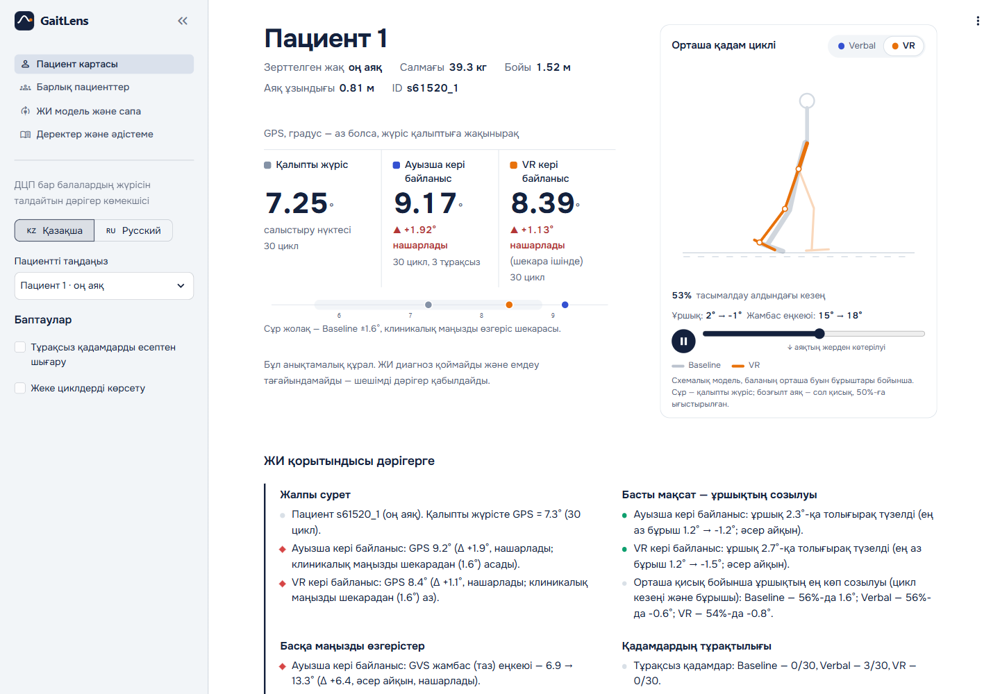
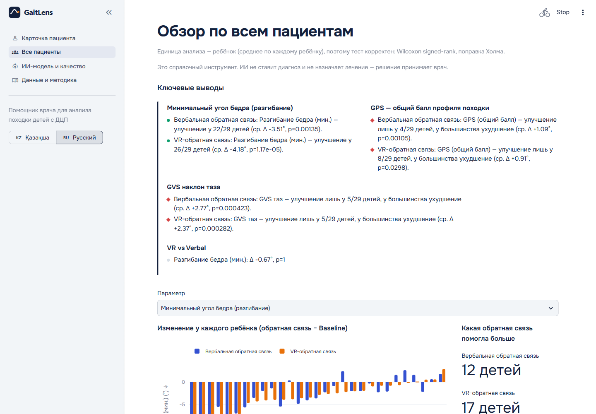
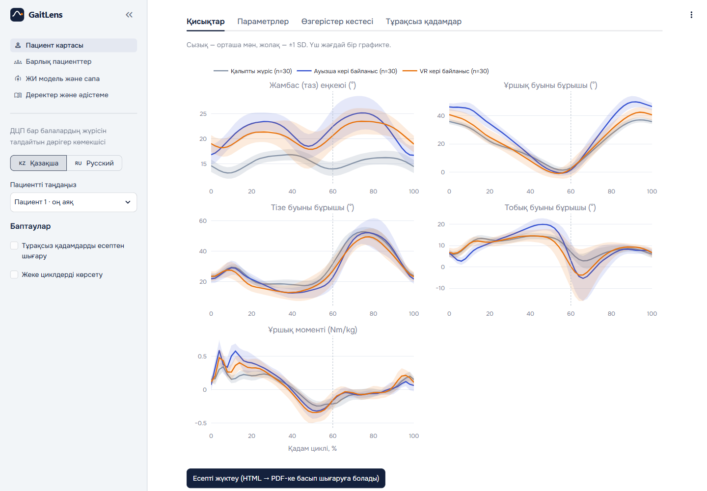
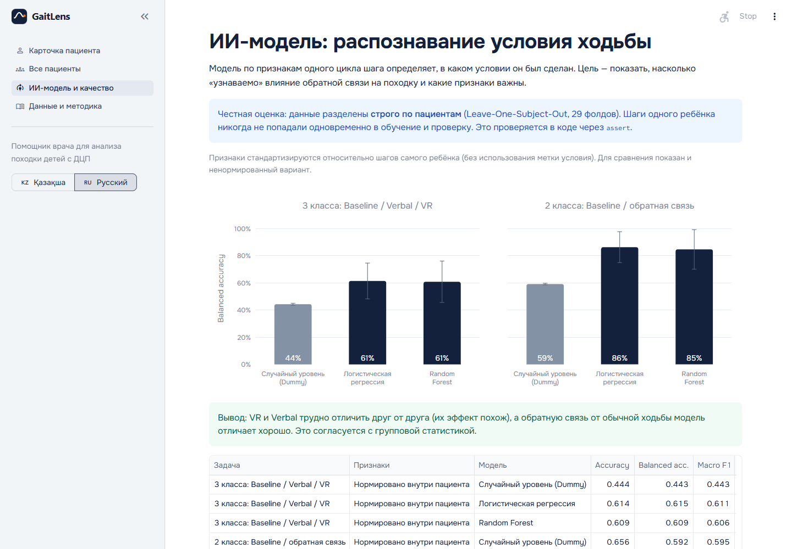

# Asyl AI — ДЦП бар балалардың жүрісін талдайтын дәрігер көмекшісі

**AI-Sana Shakarim Solveathon: AI & Medicine-2026 · Мектеп трегі**

> Asyl AI — анықтамалық құрал. ЖИ диагноз қоймайды және ем тағайындамайды; шешімді дәрігер қабылдайды.
> Asyl AI — справочный инструмент. ИИ не ставит диагноз и не назначает лечение; решение принимает врач.

**Сайт / Сайт:** https://asylbolatkhan.github.io/asyl-ai/

## Жоба құрамы / Состав проекта
| Бөлік | Не | Қалай ашу |
|---|---|---|
| **[web/](web/)** — **Asyl AI платформасы** (негізгі өнім) | Браузерде жұмыс істейтін интерфейс: салыстыру, ЖИ қорытындысы, жүріс анимациясы, есеп, KZ/RU, қараңғы тақырып | `web/index.html` файлын екі рет басыңыз. Орнату қажет емес, интернет те керек емес |
| **[gaitlens/](gaitlens/)** — талдау қозғалтқышы (Python) | Статистика, күмәнді қадамдар, пациент бойынша бөлінген ML, дәрігерге мәтін; 42 автоматты тест | `python scripts/export_web.py` нәтижені `web/js/analysis.js` файлына жазады |
| [app.py](app.py) — зерттеушінің Streamlit нұсқасы | Сол талдаудың толық, интерактивті нұсқасы | `streamlit run app.py` |
| [presentation/](presentation/) | 10 слайдтық таныстырылым (PDF + HTML) | `presentation/Asyl_AI_Solveathon_2026.pdf` |

**Басты нәтиже.** Кері байланыс 26/29 балада (VR) ұршықтың созылуын жақсартты, бірақ 21/29 балада жалпы жүріс профилі (GPS) нашарлады: бала ұршықты жамбасты алға еңкейту арқылы түзейді. Модель әр қадамды талдап, кері байланысты 86% (кездейсоқ деңгей 59%) дәлдікпен таниды, бала оқытуға қатыспай бөлек тексеріледі.

**ЖИ мәтіндері.** Дәрігерге арналған қорытынды алдымен есептелген сандардан ереже бойынша құрылады, содан кейін GPT-5.4 (OpenAI) оны түсінікті етіп қайта жазады. Мәтіндегі әр сан есептелген деректермен автоматты салыстырылады; деректерде жоқ сан болса, мәтін қабылданбайды. Мәтіндер алдын ала жасалады, сондықтан API кілті сайтта жоқ.

```bash
python scripts/export_web.py          # талдауды web/js/analysis.js-ке жаңарту
python scripts/export_web.py --llm    # ЖИ мәтіндерін қайта жасау (кілт .env файлында: OPENAI_API_KEY=...)
```

### Streamlit нұсқасының скриншоттары
| Пациент картасы (KZ) | Топтық шолу (RU) |
|---|---|
|  |  |
| **Буын қисықтары (KZ)** | **ЖИ модель (RU)** |
|  |  |

**Демо-есептер / Демо-отчёты:** [`demo/`](demo/) қалтасында. Оларды браузерде ашып көріңіз / откройте в браузере:
- `s61520_1`: типтік жағдай. Ұршықтың созылуы жақсарды, бірақ GPS нашарлады. / Типичный случай: разгибание бедра улучшилось, но GPS ухудшился.
- `s61520_7`: кері байланыс ұршықтың созылуын жақсартпады. / Обратная связь не улучшила разгибание бедра.
- `s61520_22`: ұршық моменті жоқ, бұл деректер сапасын өңдеудің мысалы. / Нет момента бедра — пример обработки качества данных.

---

## Қазақша

### Не істейді
GaitLens 29 баланың жүрісін үш жағдайда салыстырады: **Baseline** (кәдімгі жүріс), **Verbal** (ауызша кері байланыс) және **VR** (виртуалды шындық арқылы кері байланыс). Дәрігер баланы таңдайды да мыналарды көреді:

| Бет | Мазмұны |
|---|---|
| 🧒 **Пациент картасы** | Үш жағдайдың GPS көрсеткіштері, есепке алынған циклдер саны, **ЖИ қорытындысы**, буын бұрыштарының қисықтары (орташа ± SD), параметрлер, Baseline-ға қатысты өзгерістер кестесі, тұрақсыз қадамдар және **HTML есепті жүктеу** (PDF-ке басып шығаруға болады) |
| 👥 **Барлық пациенттер** | Топтық талдау: әр баладағы өзгеріс, Wilcoxon тесті, негізгі тұжырымдар |
| 🧠 **ЖИ модель** | Жүріс жағдайын тану, адал метрикалар, қателер матрицасы, белгілердің маңыздылығы |
| 📚 **Деректер және әдістеме** | Деректер сапасы, әдістер, этика, дереккөздер |

Интерфейс екі тілде жұмыс істейді: **қазақша / орысша**. Тіл сол жақтағы панельде ауыстырылады.

### Жүріс анимациясы және дизайн
- **Жүріс анимациясы.** Пациент картасының басында баланың **нақты орташа буын бұрыштарынан** (жамбас, ұршық, тізе, тобық) құрылған аяқ анимациясы тұр. Ол тура кинематика арқылы есептеледі ([gaitlens/gait_anim.py](gaitlens/gait_anim.py)).
  - Baseline сұр «елес» түрінде, ал Verbal/VR түсті болып бір-бірінің үстіне түседі.
  - Кідіртуге, циклдің кез келген сәтін таңдауға және ұршық пен жамбас бұрыштарын нақты уақытта көруге болады.
  - Қосымша кітапханасыз жазылған, таза SVG мен JS.
- **Дизайн жүйесі** «клиникалық таза» стильде ([gaitlens/theme.py](gaitlens/theme.py)).
  - Onest қарпі қазақ әріптерін толық қолдайды. Ол жергілікті `static/fonts/` қалтасында тұр, сондықтан интернетсіз де жұмыс істейді.
  - Жағдай түстері colorblind-тексеруінен өтті.
  - Экранды телефон еніне дейін кішірейтуге болады.
  - `prefers-reduced-motion` қосулы болса, анимация кідіртілген күйде басталады.

### ЖИ бөлігі
1. **Маңызды өзгерістерді табу.** Әр параметр бойынша Mann-Whitney тесті (Holm түзетуімен) және Cliff's delta есептеледі, өзгерістер маңыздылығы бойынша реттеледі. GPS үшін клиникалық маңызды ең аз өзгеріс — 1.6°.
2. **Тұрақсыз қадамдарды анықтау.** Әр қадамның баланың медианалық қадамынан қашықтығы робаст z-score арқылы бағаланады, қосымша IsolationForest қолданылады.
3. **Жағдайды тану (ML).** Логистикалық регрессия мен Random Forest. Бағалау **тек пациент бойынша** бөлінеді (Leave-One-Subject-Out).
4. **Дәрігерге мәтіндік қорытынды.** Екі тілде шаблон арқылы жасалады, МКФ-тың b770 және d450 санаттарымен байланыстырылады. Қаласаңыз, мәтінді Claude API жетілдіре алады.

### Модель сапасы (Leave-One-Subject-Out, 2606 цикл, 29 пациент)
| Есеп | Кездейсоқ деңгей | Логистикалық регрессия | Random Forest |
|---|---|---|---|
| Baseline / Verbal / VR (3 класс) | 0.44 | **0.62** | 0.61 |
| Baseline / кері байланыс (2 класс) | 0.59 | **0.86** | 0.85 |

Кестеде balanced accuracy көрсетілген. VR мен Verbal-дың әсері ұқсас, сондықтан оларды бір-бірінен ажырату қиын. Ең маңызды белгі — тірек фазасының соңындағы ұршық бұрышы (`aSagH_tst`). Кері байланыстың мақсаты дәл осы көрсеткіш еді.

### Іске қосу
```bash
python -m venv .venv
# Windows:  .venv\Scripts\activate      Linux/macOS:  source .venv/bin/activate
pip install -r requirements.txt
streamlit run app.py             # http://localhost:8501
pytest                           # тесттер
python scripts/train_eval.py     # (міндетті емес) модельді қайта бағалау, ~5 мин; models/metrics.json репозиторийде бар
python scripts/make_demo.py      # (міндетті емес) demo/ ішіндегі есептерді қайта жасау
```
Claude опциясын қосу үшін: `pip install anthropic`, содан кейін `ANTHROPIC_API_KEY` айнымалысын орнатыңыз. Кілт болмаса, бұл опция көрсетілмейді, ал қосымша шаблонды қорытындымен толық жұмыс істейді.

### Тестілеу
`pytest` 40 тестті іске қосады. Claude-қа қатысты 3 тест тек `anthropic` орнатылғанда орындалады, әйтпесе өткізіліп жіберіледі. Тесттер мыналарды тексереді:
- CSV-ны оқу: үтірлі сандар, NaN және бос өрістер;
- статистикалық функциялар;
- ML бағалауда пациенттер бойынша қиылыс жоқтығын;
- 4 беттің әрқайсысы екі тілде қатесіз ашылатынын;
- s7, s22 сияқты күрделі пациенттерді;
- HTML есепті;
- Claude сұранысын жалған HTTP-транспорт арқылы, бас тарту (refusal) мен қате кезінде шаблонға қайту;
- жүріс анимациясының кинематикасын: кесінділер ұзындығы тұрақты, NaN жоқ, табан жерге тиеді.

---

## Русский

### Что делает
GaitLens сравнивает походку 29 детей в трёх условиях: **Baseline** (обычная ходьба), **Verbal** (вербальная обратная связь) и **VR** (обратная связь через виртуальную реальность). Врач выбирает пациента и видит:

| Страница | Содержание |
|---|---|
| 🧒 **Карточка пациента** | GPS в трёх условиях, число учтённых циклов, **ИИ-сводка**, кривые углов суставов (среднее ± SD), параметры, таблица изменений относительно Baseline, нестабильные шаги и **скачивание HTML-отчёта** (можно распечатать в PDF) |
| 👥 **Все пациенты** | Групповой анализ: изменение у каждого ребёнка, тест Уилкоксона, ключевые выводы |
| 🧠 **ИИ-модель** | Распознавание условия ходьбы, честные метрики, матрица ошибок, важность признаков |
| 📚 **Данные и методика** | Качество данных, методы, этика, источники |

Интерфейс двуязычный: **казахский / русский**. Язык переключается на левой панели.

### ИИ-часть
1. **Поиск значимых изменений.** По каждому параметру считаются тест Манна-Уитни (с поправкой Холма) и Cliff's delta, изменения ранжируются по значимости. Для GPS используется минимальное клинически значимое изменение 1.6°.
2. **Выявление нестабильных шагов.** Расстояние каждого шага до медианного шага ребёнка оценивается робастным z-score, дополнительно применяется IsolationForest.
3. **Распознавание условия (ML).** Логистическая регрессия и Random Forest. При оценке данные делятся **строго по пациентам** (Leave-One-Subject-Out).
4. **Текстовая сводка для врача.** Генерируется по шаблону на двух языках и связывается с категориями МКФ b770 и d450. По желанию текст может улучшить Claude API.

### Запуск
См. команды в разделе «Іске қосу» выше. Для опции Claude: `pip install anthropic`, затем задайте `ANTHROPIC_API_KEY`.

---

## Структура / Құрылым
```
app.py                 # навигация, тіл / язык
views/                 # patient, cohort, model, about беттері
gaitlens/data.py       # CSV оқу (; , NaN), циклдерді біріктіру
gaitlens/analysis.py   # бір пациентті толық талдау (UI-ден тәуелсіз)
gaitlens/gait_anim.py  # жүріс анимациясының кинематикасы + есепке арналған филмстрип
gaitlens/components/   # анимация компоненті (SVG + JS)
gaitlens/theme.py      # дизайн токендері, CSS
gaitlens/widgets.py    # пациент бетінің HTML блоктары
static/                # Onest қарпі (OFL), логотип
gaitlens/stats.py      # өзгерістер, effect size, топтық тесттер
gaitlens/anomalies.py  # тұрақсыз қадамдар
gaitlens/model.py      # ML + subject бойынша бағалау
gaitlens/summary.py    # мәтіндік қорытынды (шаблон + Claude опциясы)
gaitlens/report.py     # HTML есеп
gaitlens/i18n.py       # KZ / RU мәтіндер
scripts/train_eval.py  # модельді бағалау → models/metrics.json
scripts/make_demo.py   # демо-есептер → demo/
tests/                 # pytest (деректер, статистика, UI, есеп, Claude mock)
docs/screenshots/      # скриншоттар
```

## Лицензия
Код: [MIT](LICENSE). Деректер (`gait-cp-dataset/`): CC-BY-NC-SA-4.0, авторлары — KU Leuven.

## Дереккөздер / Источники
Толығырақ: [DATA_SOURCES.md](DATA_SOURCES.md).
Деректер: De Mulder T. et al., KU Leuven RDR, 2024, https://doi.org/10.48804/JUNNWW, лицензиясы **CC-BY-NC-SA-4.0**.
